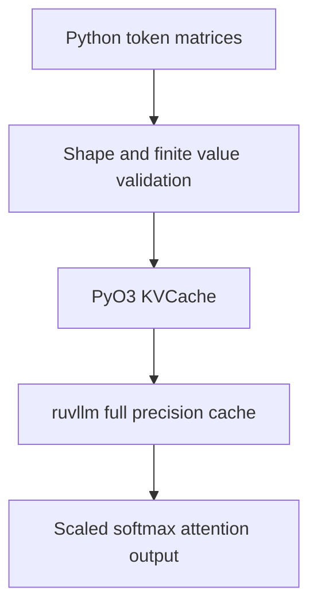

# ruvector-ruvllm: Native Rust KV cache for Python


## What is ruvector-ruvllm?

A bounded CPU key/value cache and attention primitive for Python LLM pipelines, backed by the actual `ruvllm` Rust crate. Store key/value token vectors and query them with scaled dot product attention. This focused Python package exposes cache operations, **not text generation or full npm ruvllm feature parity**. No model weights or hosted services are required.

## Getting started

Requires Python 3.10 or newer and a platform supported by `ruvector==0.1.4` native wheels.

```bash
pip install ruvector-ruvllm==0.2.0
```

This version requires publication of both the package and its pinned native runtime before that command works. In a source checkout, build/install the native SDK first, then install `./python/portfolio/ruvector-ruvllm`.

```python
from ruvector_ruvllm import TokenCache

cache = TokenCache(dimensions=2, max_tokens=128)
cache.append(keys=[[1.0, 0.0], [0.0, 1.0]],
             values=[[2.0, 4.0], [8.0, 10.0]])
answer = cache.attend([1.0, 0.0])
assert answer.shape == (2,)
assert len(cache) == 2
keys, values = cache.get_all()
assert keys.shape == values.shape == (2, 2)
cache.clear()
assert len(cache) == 0
```

## Architecture



The shared runtime keeps computation in Rust. The row-shaped Python interface converts inputs to float32. For flat inputs, `from ruvector_ruvllm import KVCache` exposes the native class directly.

## API and limits

| Operation | Behavior |
| --- | --- |
| `TokenCache(dimensions, max_tokens=4096)` | Create an empty bounded cache |
| `append(keys, values)` | Add matching matrices shaped `(tokens, dimensions)` |
| `attend(query, scale=None)` | Return float32 vector; default scale is `1/sqrt(dimensions)` |
| `get_all()` | Copy all keys and values into matrices |
| `clear()` | Remove all tokens |
| `len(cache)` | Number of stored tokens |

Attention treats each token as one vector, not independent attention heads. The implementation retains full float32 precision, with no quantization, sliding window or automatic eviction. Capacity errors leave the cache unchanged. Empty-cache attention returns zeros.

Dimensions are limited to 4096, tokens to 65536, and their product to 8388608. Raw keys and values therefore occupy at most 64 MiB, excluding objects, conversion buffers and returned copies. Coordinates must be finite and have absolute value at most `1e10`. Isolate untrusted workloads with process memory limits because Python conversion can allocate before native validation.

## Relationship to npm and Rust

Inspired by the popular npm `ruvllm` package, using the repository's real Rust cache implementation. This release does not expose model loading, tokenization, GPU inference, serving, learning or text generation. It ships a focused wrapper over the shared `ruvector` native runtime rather than a separate binary engine.

Source: [RuVector](https://github.com/ruvnet/RuVector). [Security policy](https://github.com/ruvnet/RuVector/blob/main/python/portfolio/SECURITY.md). License: MIT.
