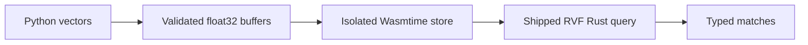

# ruvector-rvf-wasm


Run the actual Rust RVF WebAssembly microkernel from Python. This package bundles the 39,501-byte artifact shipped in `@ruvector/rvf-wasm@0.1.9`, verified against npm registry SHA512 integrity, and executes it with Wasmtime. No Node, browser, WASI, network imports, or replacement distance implementation.

## Getting started

```bash
python -m pip install ruvector-rvf-wasm==0.2.0
```

```python
from ruvector_rvf_wasm import VectorStore

with VectorStore(2, metric="l2") as vectors:
    vectors.add(10, [0.0, 0.0])
    vectors.add(20, [3.0, 4.0])
    hits = vectors.query([0.0, 0.0], k=2)
    assert [(hit.id, hit.distance) for hit in hits] == [(10, 0.0), (20, 25.0)]
```

## Execution diagram



## What is implemented?

`VectorStore` supports insertion and nearest-vector queries over unique unsigned 64-bit IDs. Metrics are squared L2 (`l2`), negative dot product (`inner_product`), and cosine distance (`cosine`). Smaller distances rank first. The shipped store performs exhaustive distance comparisons; this wrapper does not claim HNSW acceleration. State is in memory only. Export/import and other low-level ABI operations are not exposed in this initial wrapper.

Each instance owns an isolated import-free VM. Default limits are 64 MiB linear memory and 10 million fuel units per public operation, with a maximum of 100,000 vectors, 4,096 dimensions and 10,000 returned matches. Fuel measures Wasm execution, not elapsed seconds. Numeric magnitudes are capped at 1e15 to prevent float32 distance overflow. Cosine vectors are normalized in Python float64 before float32 conversion; zero norm vectors are rejected. Iterator inputs consume at most dimensions plus one elements. Memory and fuel limits govern the Wasm VM, not arbitrary Python code inside user supplied iterators. Traps close the instance. Context managers release VM resources. Calls on one instance serialize through a lock.

## Provenance and compatibility

The wheel bundles `provenance.json` with the exact npm URL, SHA512 archive integrity and SHA256 Wasm digest. The digest is checked before each instantiation. This detects accidental artifact changes; it is not an independent publisher signature. Upstream declares MIT licensing; the repository MIT license is included.

Wasmtime is pinned to `49.0.0`. The shared portfolio runtime is pinned to `ruvector==0.1.4`, although the operations shown here execute the bundled Wasm directly. Installation depends on compatible wheels being available for both dependencies. Python 3.10 or later is required.

Source and issues: [RuVector](https://github.com/ruvnet/RuVector). The quickstart is an acceptance test of real Wasm insertion, distance computation and result decoding.
