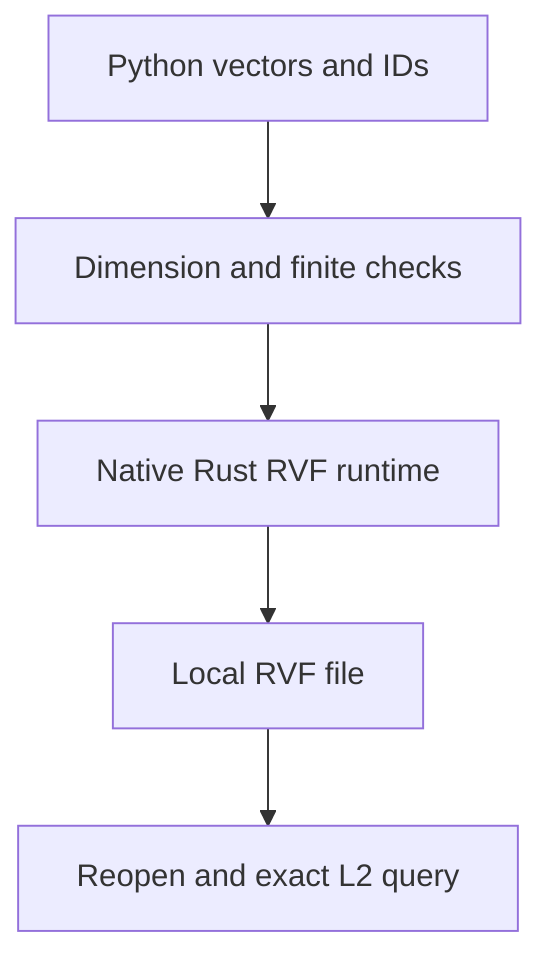

# RuVector RVF for Python


Create a local vector file, store embeddings with integer identifiers, search by L2 distance, and reopen the file later. `ruvector-rvf` wraps the real Rust `rvf-runtime` through the shared `ruvector` native extension. It is a focused Python counterpart to the storage operations in `@ruvector/rvf`, not full API parity.

## Getting started

Requires Python 3.10 or newer and a platform supported by `ruvector==0.1.3`.

```bash
python -m pip install ruvector-rvf==0.2.0
```

```python
from pathlib import Path
from tempfile import TemporaryDirectory
from ruvector_rvf import RvfStore

with TemporaryDirectory() as directory:
    path = str(Path(directory) / "documents.rvf")
    store = RvfStore.create(path, dimension=3)
    try:
        assert store.ingest([[1, 0, 0], [0, 1, 0]], [10, 20]) == 2
        hits = store.query([1, 0, 0], k=1)
        assert hits[0][0] == 10
    finally:
        store.close()

    reopened = RvfStore.open(path)  # Read only by default.
    try:
        assert reopened.status()["total_vectors"] == 2
        assert reopened.query([0, 1, 0], k=1)[0][0] == 20
    finally:
        reopened.close()
```

## How storage works



`query` returns `(id, distance)` pairs with smaller distances preferred. This initial binding forces exact search for predictable semantics; latency grows with the number and dimension of stored vectors. It does not expose metadata, approximate search tuning, compression, branching, or signature APIs.

## API and limits

| Operation | Behavior |
| --- | --- |
| `RvfStore.create(path, dimension)` | Creates a new file, refusing existing paths; dimension 1 through 4096 |
| `RvfStore.open(path, read_only=True)` | Opens an existing trusted file |
| `store.ingest(vectors, ids)` | Returns accepted count; 1 through 10000 finite vectors of magnitude at most 1e10 with matching dimensions and unique batch IDs |
| `store.query(vector, k=10)` | Exact L2 retrieval; k 1 through 10000 |
| `store.delete(ids)` | Soft deletion; returns deleted count |
| `store.status()` | Live vector count, bytes, epoch, and integer read_only flag |
| `store.close()` | Closes the handle; repeated calls are harmless |

Use `open(path, read_only=False)` before mutating an existing file. Always call `close()` in a `finally` block. Native errors become `RuntimeError`; invalid vector inputs become `ValueError`. An ingest error reporting partial acceptance means some records were committed; inspect the store before retrying.

## Security and trust

Open only locally produced RVF files you own and explicitly trust. Native file decoding occurs before the dimension limit is checked. This binding is not an untrusted file sandbox, authentication system, encrypted database, or cryptographic verification API. Dimension and batch limits constrain ordinary API requests; they are not protection against hostile Python objects or crafted files. File permissions and directory access are the application's responsibility. The native `create_new` operation prevents replacing an existing file even if another process creates it during validation.

## Development

Tests: `python -m pytest python/portfolio/tests/test_rvf_portfolio.py`. Install this package against a locally built `ruvector==0.1.3` wheel before running. Source: [RVF Rust runtime](https://github.com/ruvnet/RuVector/tree/main/crates/rvf/rvf-runtime). [Issues](https://github.com/ruvnet/RuVector/issues).
